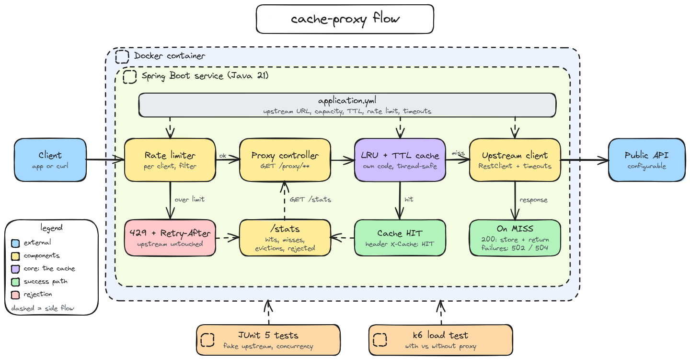

# cache-proxy
 
A Spring Boot caching reverse proxy with a hand-written LRU + TTL cache and a rate limiter.
 

     

## Overview
 
cache-proxy sits in front of a single configurable upstream HTTP API. It forwards `GET` requests, stores successful responses in a bounded in-memory cache, limits how often each client can call it, and reports hit, miss and eviction statistics.
 
The core is domain-agnostic: it knows nothing about what the upstream API means, so pointing it at another API is a configuration change, not a code change.
 
## Goal
 
This is a practice project to build the pieces behind tools like Redis and nginx by hand, and to understand them rather than just use them:
 
- an LRU cache with time-based expiry (TTL), with O(1) operations
- a per-client rate limiter
- thread safety under concurrent load
- measured impact: load tests with and without the proxy

No caching or rate-limiting libraries are used. Both are written from scratch.
 
## Architecture
 

 
A request passes the rate limiter and reaches the proxy controller, which asks the cache. A hit is returned immediately. On a miss, the service calls the upstream and caches successful (`200`) responses. `/stats` exposes the counters.
 
## Planned features
 
- Generic `GET` proxy for any upstream API
- Hand-written LRU + TTL cache with a fixed capacity
- Per-client rate limiting with `429` and `Retry-After`
- `X-Cache: HIT | MISS` header on proxied responses
- `/stats` endpoint (hits, misses, evictions, expirations, rejections)
- Clear error mapping for upstream failures (`502`, `504`)
- Thread-safe under concurrent requests

## Documentation
 
- [Requirements specification](docs/spec-v1.md)

 